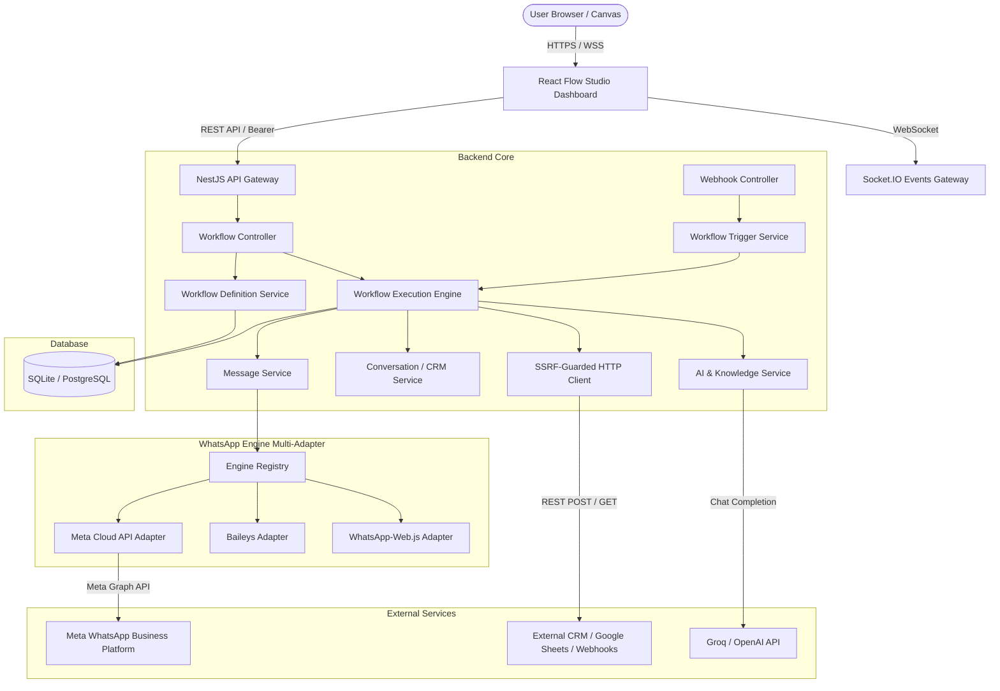

# ARCHITECTURE.md — WhatsApp Flow Studio

## 1. Executive Summary & Product Vision

**WhatsApp Flow Studio** is a node-based, visual WhatsApp workflow automation platform inspired by the design and usability principles of n8n. It empowers both non-technical users and engineers to build, test, activate, and monitor automated WhatsApp conversation flows visually without writing custom glue code.

```
WhatsApp Incoming Message / Webhook / Schedule / Manual
                         ↓
                   Message Filter
                         ↓
               AI Message Classifier
                         ↓
                    IF / ELSE
                 ↙           ↘
          Google Sheets     WhatsApp Reply
                 ↓                 ↓
                       Execution Log
```

---

## 2. Technology Stack & Component Structure

### Frontend (SPA & Studio Canvas)
- **Framework:** React 19 with TypeScript, bundled with Vite.
- **Workflow Canvas:** `@xyflow/react` (React Flow) for zoomable, pannable, drag-and-drop node graphs with custom styled handles and edge routing.
- **Component System & Icons:** Modular component styling, Lucide React icons, accessible dialogs with focus trapping, and responsive layouts.
- **State Management & Server Cache:** `@tanstack/react-query` for query deduplication, optimistic updates, and cache eviction; local state hooks for editor state.
- **Internationalization:** `react-i18next` with English and Gujarati (gu-IN) readiness.

### Backend (REST API & Workflow Execution Engine)
- **Runtime & Framework:** Node.js v20+ / v24, NestJS 10 with modular architecture.
- **Data Persistence:** TypeORM with dual-database support:
  - SQLite for single-node / local deployments (`data/database.sqlite`).
  - PostgreSQL for high-concurrency production deployments.
- **Real-Time Communication:** WebSockets (`socket.io` Gateway) for instant event dispatch (inbound message stream, live execution updates, QR codes).
- **Security & Safety Guardrails:**
  - Strict SSRF (Server-Side Request Forgery) guard on all outbound HTTP / Webhook requests blocking AWS/GCP metadata (`169.254.169.254`), loopbacks, private RFC1918 subnets, and DNS rebinding.
  - Role-Based Access Control (`admin`, `operator`, `viewer`) and API Key authentication.
  - No `eval` execution: safe token and JSON-path expression interpolation (`{{trigger.*}}`, `{{steps.*}}`, `{{vars.*}}`).

### WhatsApp Engine Multi-Adapter Layer
- **Official Meta WhatsApp Cloud API (`CloudApiAdapter`):** Graph API v21.0 integration for enterprise phone numbers, template synchronization, webhooks, and direct REST messaging.
- **Baileys Adapter:** WebSocket-based multi-device protocol implementation.
- **WhatsApp-Web.js Adapter:** Headless Chromium / Puppeteer session manager.

---

## 3. High-Level Architecture Diagram



---

## 4. Node Registry & Execution Model

The platform treats every node as a standardized unit with a lifecycle: `validate` -> `dry_run` -> `execute` -> `route`.

### A. Supported Node Categories

| Category | Node Types | Purpose |
|---|---|---|
| **Triggers** | `trigger` (Manual, Message Received, Keyword Match, Webhook, Schedule) | Initiates workflow execution upon inbound events or manual tests. |
| **WhatsApp Actions** | `send_message`, `send_template`, `send_media`, `send_location`, `send_reaction`, `interactive_buttons` | Dispatches official messages, interactive menus, media, and templates. |
| **Logic & Control** | `condition_branch` (IF/ELSE), `filter`, `wait` (Delay), `stop_workflow`, `handoff_to_human` | Directs execution flow, delays, human intervention, or conditional stops. |
| **Data & Transforms**| `set_fields`, `ask_question`, `parse_json`, `text_template` | Variables assignment, slot capture (email/phone), and formatting. |
| **Integrations** | `webhook_call` (HTTP Request), `google_sheets` | REST API calls, external webhook posting, and spreadsheet row appends. |
| **AI Nodes** | `ai_assistant`, `ai_classifier` | Intent classification, RAG customer replies, and structured extraction. |

### B. Execution Context & Data Envelope

Every node step receives and enriches a standard immutable data envelope:

```typescript
export interface TriggerContext {
  businessId: string;
  sessionId?: string;
  chatId?: string;
  contactId?: string;
  contactTags?: string[];
  messageBody?: string;
  messageType?: string;
  conversationId?: string;
  conversationStatus?: string;
  assignedTo?: string;
  metadata?: {
    isTest?: boolean;      // Dry-run mode flag
    contactName?: string;
    [key: string]: unknown;
  };
}
```

Variable resolution is scoped deterministically:
1. `{{trigger.phone}}`, `{{trigger.message}}`, `{{trigger.contactName}}` — Inbound trigger context.
2. `{{steps.<nodeId>.data}}`, `{{steps.<nodeId>.status}}` — Outputs from upstream nodes.
3. `{{vars.<variableName>}}` — Variables assigned via `set_fields` or captured via `ask_question`.
4. `{{now}}`, `{{today}}`, `{{date}}`, `{{randomId}}` — Standard runtime utilities.

---

## 5. Security & Isolation Architecture

1. **Dry-Run Safety Guarantee:**
   When a test run is initiated from the studio (`metadata.isTest = true` or dry-run enabled), outbound WhatsApp send operations log the simulated payload and return mock message IDs without making live calls to WhatsApp, protecting user quotas and recipient privacy.

2. **SSRF Protection on HTTP/Webhook Nodes:**
   Every HTTP request generated by workflow nodes undergoes IP validation before DNS resolution and dispatch:
   - Private subnets (RFC 1918: `10.0.0.0/8`, `172.16.0.0/12`, `192.168.0.0/16`) are blocked by default.
   - Cloud metadata IP (`169.254.169.254`) is strictly blocked.
   - Local loopbacks (`127.0.0.1`, `localhost`) are blocked unless explicitly running in local dev test mode.

3. **Tenant & API Key Isolation:**
   All workflow definitions, runs, and credentials are scoped by `businessId`. Requests validate membership permissions before read, modify, or execution actions.

---

## 6. Fault Tolerance & Reliability

- **Step-by-step Audit Trail:** Every node execution persists a `StepResult` record with `startedAt`, `completedAt`, `status`, `output`, and `error`.
- **Bounded Execution:** Workflows enforce `maxActionsPerRun` (default 100) and `maxExecutionSeconds` (default 300) to prevent infinite graph loops.
- **Configurable Retries:** Action nodes support exponential backoff retries with jitter for transient external API failures.
- **Graceful Pausing:** `wait` and `ask_question` nodes cleanly suspend workflow execution and resume upon incoming message or timeout expiration.
