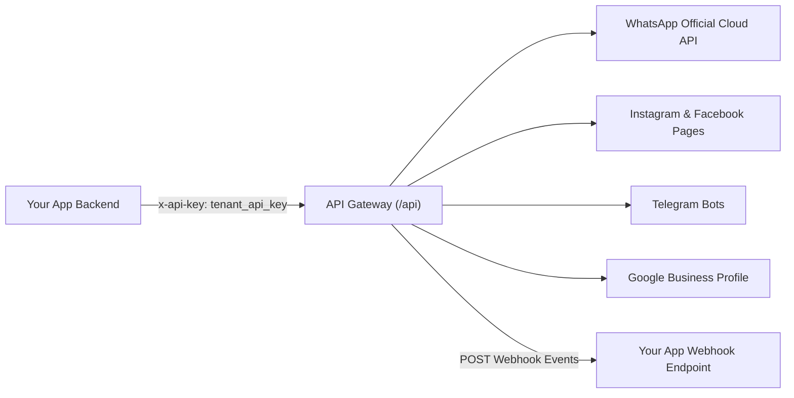

# Partner Integration Guide — Multi-Platform API Gateway

Welcome to the **Multi-Platform API Gateway** (powered by OpenWA / Artha). This guide provides everything required to integrate **Official WhatsApp Business (Cloud API)**, **Instagram**, **Facebook**, **Telegram**, and **Google Business Profile** directly into your application.

---

## 1. Architecture & Multi-Tenancy

Each of your application's clients/organizations maps to an isolated **Tenant (Business)** on our platform. Every tenant receives its own scoped **API Key**, ensuring that messages, contacts, sessions, and social accounts never collide across tenants.



---

## 2. Authentication

Every API call (except public webhooks and OAuth callbacks) requires an API key in the request header:

```http
x-api-key: owa_k1_your_api_key_here
Content-Type: application/json
```

---

## 3. Tenant Provisioning (Super Admin API)

Your backend can programmatically provision a business and its dedicated API key whenever a new customer registers on your platform.

### Create a New Tenant & API Key
```http
POST /api/provisioning/tenants
x-api-key: <YOUR_MASTER_ADMIN_KEY>
Content-Type: application/json

{
  "businessName": "Sunrise Retailers",
  "slug": "sunrise-retailers",
  "plan": "pro"
}
```

**Response (201 Created):**
```json
{
  "business": {
    "id": "b8f52f36-58be-4ad7-b86a-72ef6d31c4b1",
    "name": "Sunrise Retailers",
    "slug": "sunrise-retailers",
    "plan": "pro"
  },
  "apiKey": {
    "id": "e4c1964f-4d37-4d92-bf36-1e0e84b245a9",
    "key": "owa_k1_9f3b892a012d93e...",
    "name": "Sunrise Retailers Admin",
    "role": "admin",
    "keyPrefix": "owa_k1_9f3b"
  }
}
```
> [!IMPORTANT]
> The `apiKey.key` is returned **only once** upon creation. Store it securely in your database associated with that tenant. Use this key for all subsequent calls on behalf of that tenant.

---

## 4. Platform Connections (`/api/platforms`)

Once you have the tenant's API key, connect their accounts using the unified endpoints.

### A. WhatsApp Official (Cloud API)

Connect an official Meta WhatsApp Business phone number. **No QR code scanning or background browser is required.**

```http
POST /api/platforms/connect/whatsapp
x-api-key: <TENANT_API_KEY>
Content-Type: application/json

{
  "name": "sunrise-wa-01",
  "accessToken": "EAAX...Permanent_Meta_System_User_Token",
  "phoneNumberId": "1021641607698168",
  "wabaId": "2322546001604284",
  "appSecret": "your_meta_app_secret",
  "verifyToken": "your_custom_verify_token"
}
```

**Response (201 Created):**
```json
{
  "id": "908d2777-628f-4318-8a21-7f93f18bf0a0",
  "name": "sunrise-wa-01",
  "status": "WORKING",
  "platform": "whatsapp-cloud-api",
  "createdAt": "2026-11-21T22:30:00.000Z"
}
```

---

### B. Instagram & Facebook Pages

Connect an Instagram Business account or Facebook Page using the Meta Page Access Token.

```http
POST /api/platforms/connect/social
x-api-key: <TENANT_API_KEY>
Content-Type: application/json

{
  "platform": "instagram",
  "accountName": "Sunrise Instagram",
  "accountId": "17841400000000000",
  "accessToken": "EAAX...Meta_Page_Access_Token",
  "pageId": "100234567890123"
}
```

*For Facebook Page, simply set `"platform": "facebook"`.*

---

### C. Telegram Bot

Connect a Telegram bot using the bot token from [@BotFather](https://t.me/BotFather).

```http
POST /api/platforms/connect/social
x-api-key: <TENANT_API_KEY>
Content-Type: application/json

{
  "platform": "telegram",
  "accountName": "Sunrise Support Bot",
  "accessToken": "123456789:ABCdefGHIjklMNOpqrSTUvwxYZ"
}
```

---

### D. Google Business Profile & Google Workspace

Start the Google OAuth 2.0 flow to connect Google Business Profile, Gmail, Google Sheets, or Google Calendar:

```http
POST /api/platforms/connect/google
x-api-key: <TENANT_API_KEY>
Content-Type: application/json

{
  "services": ["business", "gmail", "sheets"]
}
```

**Response (200 OK):**
```json
{
  "authUrl": "https://accounts.google.com/o/oauth2/v2/auth?client_id=...",
  "state": "550e8400-e29b-41d4-a716-446655440000"
}
```
Redirect your user to `authUrl`. Once they approve permissions, Google redirects to the callback and the connection status becomes `connected`.

---

### E. View All Connected Platforms

Fetch all active channels for the tenant in a single call:

```http
GET /api/platforms/connected
x-api-key: <TENANT_API_KEY>
```

**Response (200 OK):**
```json
{
  "whatsapp": [
    {
      "id": "908d2777-...",
      "name": "sunrise-wa-01",
      "phone": "+919876543210",
      "status": "WORKING",
      "platform": "whatsapp-cloud-api"
    }
  ],
  "instagram": [
    {
      "id": "3b29c...",
      "name": "Sunrise Instagram",
      "accountId": "17841400000000000",
      "status": "connected",
      "platform": "instagram"
    }
  ],
  "facebook": [],
  "telegram": [],
  "google": [
    {
      "id": "1a7d...",
      "name": "Google Business Profile",
      "type": "google_business",
      "status": "connected",
      "platform": "google_business"
    }
  ]
}
```

---

## 5. Sending Messages & Publishing Content

### Send WhatsApp Text Message
```http
POST /api/sessions/sunrise-wa-01/messages/text
x-api-key: <TENANT_API_KEY>
Content-Type: application/json

{
  "chatId": "919876543210@c.us",
  "text": "Hello! Your order #1234 has shipped."
}
```

### Send WhatsApp Media (Image/PDF/Invoice)
```http
POST /api/sessions/sunrise-wa-01/messages/image
x-api-key: <TENANT_API_KEY>
Content-Type: application/json

{
  "chatId": "919876543210@c.us",
  "file": {
    "mimetype": "application/pdf",
    "filename": "invoice_1234.pdf",
    "url": "https://your-cdn.com/invoices/1234.pdf"
  },
  "caption": "Please find attached your invoice."
}
```

### Publish / Schedule Post on Instagram & Facebook
```http
POST /api/social-automation/posts
x-api-key: <TENANT_API_KEY>
Content-Type: application/json

{
  "accountId": "<SOCIAL_ACCOUNT_UUID>",
  "caption": "Check out our weekend sale! 🎉 #sale #offers",
  "mediaUrls": ["https://your-cdn.com/posts/banner.jpg"],
  "mediaType": "IMAGE",
  "scheduledAt": "2026-11-25T10:00:00.000Z"
}
```

### Reply to Google Business Profile Review
```http
POST /api/google-business/reviews/<REVIEW_ID>/reply
x-api-key: <TENANT_API_KEY>
Content-Type: application/json

{
  "comment": "Thank you for the 5-star rating! We hope to see you again soon."
}
```

---

## 6. Receiving Real-Time Events (Webhooks)

Register your application's webhook URL to receive instant push notifications whenever events occur.

### Register Webhook for a Tenant's WhatsApp Session
```http
POST /api/sessions/sunrise-wa-01/webhooks
x-api-key: <TENANT_API_KEY>
Content-Type: application/json

{
  "url": "https://your-app.com/api/webhooks/openwa",
  "events": [
    "message.received",
    "message.ack",
    "social.message.received",
    "social.comment.received"
  ],
  "secret": "your_webhook_hmac_secret"
}
```

### Webhook Event Payloads

#### Incoming WhatsApp Message (`message.received`):
```json
{
  "event": "message.received",
  "sessionId": "sunrise-wa-01",
  "data": {
    "id": "wamid.HBgL...",
    "from": "919876543210@c.us",
    "sender": "John Doe",
    "text": "Hi, what are your opening hours?",
    "timestamp": 1795368600
  }
}
```

#### Incoming Instagram / Facebook DM (`social.message.received`):
```json
{
  "event": "social.message.received",
  "sessionId": "sunrise-wa-01",
  "data": {
    "channel": "instagram",
    "accountId": "3b29c...",
    "accountName": "Sunrise Instagram",
    "threadId": "178414...",
    "customerName": "sarah_k",
    "text": "Can I return an item?",
    "timestamp": "2026-11-21T22:32:00.000Z"
  }
}
```

#### Incoming Social Comment (`social.comment.received`):
```json
{
  "event": "social.comment.received",
  "sessionId": "sunrise-wa-01",
  "data": {
    "channel": "instagram",
    "accountId": "3b29c...",
    "postId": "1790123456789",
    "commentId": "179988776655",
    "fromUserName": "alex_d",
    "commentText": "Price please?",
    "liked": true,
    "replied": true,
    "replyText": "Hey Alex! Sent you a DM with details 😊",
    "status": "success",
    "timestamp": "2026-11-21T22:33:00.000Z"
  }
}
```

---

## 7. Interactive API Documentation

Interactive Swagger UI documentation is available at:
`https://api.yourdomain.com/docs` (or `/api/docs`)

You can test every endpoint live using the **Authorize** button with your `x-api-key`.
